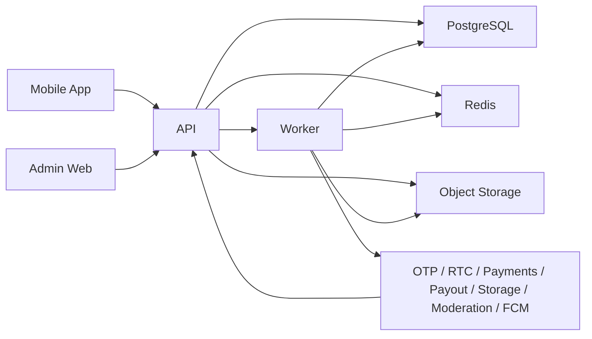
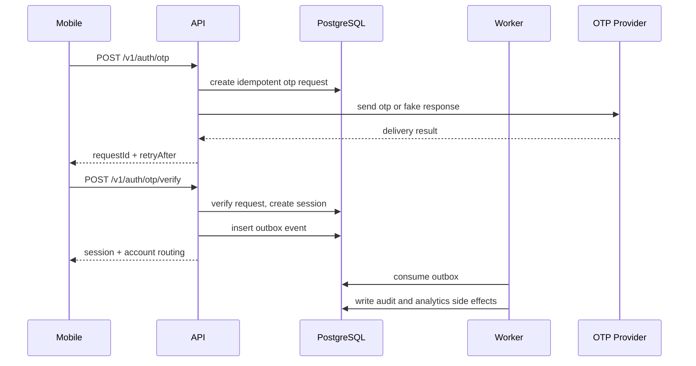
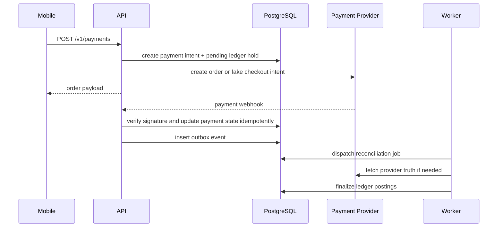
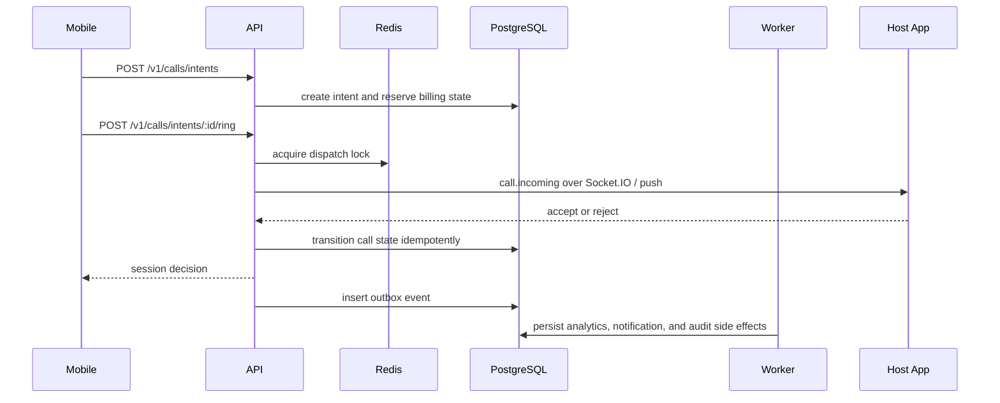
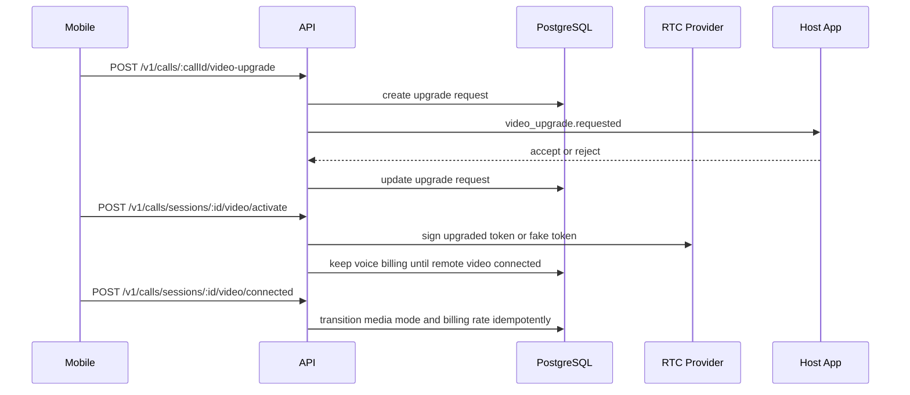
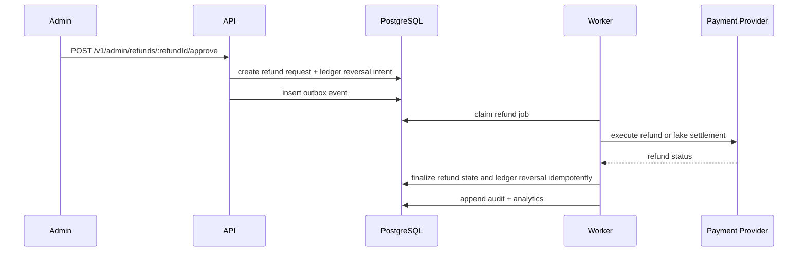
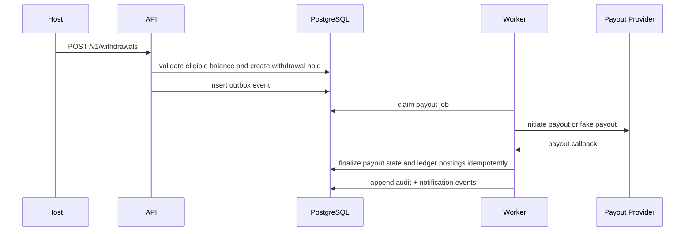

# Platform Architecture

Date: 2026-08-19

Connecto v1 runs as a modular monolith with one deployable API, one deployable
worker, one PostgreSQL database, and one Redis dependency. Mobile and admin stay
as separate frontend surfaces and integrate with the same backend contract.

## ADR Set

- [ADR-001 Modular Monolith](./adr/ADR-001-modular-monolith.md)
- [ADR-002 PostgreSQL Source Of Truth](./adr/ADR-002-postgresql-source-of-truth.md)
- [ADR-003 Redis Ephemeral Use](./adr/ADR-003-redis-ephemeral.md)
- [ADR-004 Transactional Outbox](./adr/ADR-004-transactional-outbox.md)
- [ADR-005 Provider Adapters](./adr/ADR-005-provider-adapters.md)
- [ADR-006 REST Plus Socket.IO](./adr/ADR-006-rest-plus-socket-io.md)
- [ADR-007 Separate Worker](./adr/ADR-007-separate-worker.md)
- [ADR-008 Docker-First Deployment](./adr/ADR-008-docker-first-deployment.md)

## Workspace Layout

```text
backend/
  apps/
    api/       Deployable Node API edge
    worker/    Deployable Node background worker
  packages/
    api-contracts/         REST/OpenAPI contracts and generated client source
    backend-architecture/  Canonical module graph, topology, env schema
    backend-runtime/       API/worker runtime, health, fakes, migrations, seed
    domain/                Frontend DTOs, canonical domain models, state machines
apps/
  admin/     Next.js admin website
  mobile/    Expo Router customer + host app
packages/
  design-tokens/         Shared semantic tokens
  eslint-config/         Shared ESLint rules
  test-utils/            Shared test helpers
  tsconfig/              Shared TypeScript configs
docs/
  adr/                   Architecture decisions
```

## V1 Runtime Topology

- `backend/apps/api` owns REST commands and queries, the future Socket.IO namespace, and
  provider callback ingress. It exposes `/livez`, `/readyz`, `/healthz`, and
  `/__architecture`.
- `backend/apps/worker` owns transactional outbox dispatch, reconciliation, moderation,
  notification fan-out, and payout/report follow-up jobs. It exposes the same
  liveness/readiness health contract on `WORKER_HEALTH_PORT`.
- `backend/packages/backend-runtime` owns shared process bootstrap, redacted logging,
  PostgreSQL/Redis clients, provider readiness, deterministic local fakes,
  secret-store references, migration validation/application, seed data, and
  outbox polling primitives.
- PostgreSQL is the source of truth for identity, calls, ledger, payouts,
  reports, and admin state.
- Redis is disposable. It may hold presence, throttles, locks, caches,
  Socket.IO coordination, and worker queue coordination. Correctness must
  survive Redis loss.
- Azurite-compatible object storage is available only for local development.
  Production object storage must use a configured production adapter.



## Module Boundaries

Canonical boundaries live in
`backend/packages/backend-architecture/src/modules.ts`. The current bounded modules are:

| Module          | Owns                                                       | Depends on                                                                                                          |
| --------------- | ---------------------------------------------------------- | ------------------------------------------------------------------------------------------------------------------- |
| `configuration` | environment parsing, feature flags, provider selection     | none                                                                                                                |
| `audit`         | audit envelopes, redaction policy, admin audit trail       | `configuration`                                                                                                     |
| `media`         | upload intents, storage keys, storage callbacks            | `configuration`, `audit`                                                                                            |
| `identity`      | sessions, OTP, age gate, account status                    | `configuration`, `audit`                                                                                            |
| `profiles`      | customer/host profile fields and media links               | `configuration`, `audit`, `media`, `identity`                                                                       |
| `customers`     | customer lifecycle and onboarding completion               | `configuration`, `audit`, `identity`, `profiles`                                                                    |
| `hosts`         | host application state, availability gates, host status    | `configuration`, `audit`, `identity`, `profiles`                                                                    |
| `presence`      | ephemeral online state, dispatch locks, Socket.IO presence | `configuration`, `identity`                                                                                         |
| `wallet`        | double-entry ledger, balances, transaction history         | `configuration`, `audit`                                                                                            |
| `payments`      | top-up intents, verification, reconciliation               | `configuration`, `audit`, `wallet`                                                                                  |
| `notifications` | device tokens, fan-out, delivery receipts                  | `configuration`, `audit`                                                                                            |
| `billing`       | authorization, call charging, settlement rules             | `configuration`, `audit`, `wallet`, `payments`                                                                      |
| `calls`         | intents, session lifecycle, RTC upgrade state              | `configuration`, `audit`, `customers`, `hosts`, `presence`, `billing`, `notifications`                              |
| `earnings`      | host earning postings, holds, summaries                    | `configuration`, `audit`, `wallet`, `calls`                                                                         |
| `reports`       | safety reports, block actions, moderation context          | `configuration`, `audit`, `customers`, `hosts`, `calls`, `notifications`                                            |
| `ranks`         | ranking inputs, leaderboards, manual adjustments           | `configuration`, `audit`, `calls`, `earnings`, `reports`                                                            |
| `matching`      | tag matching, discovery filtering, ranked host lists       | `configuration`, `customers`, `hosts`, `profiles`, `ranks`                                                          |
| `referrals`     | invite codes, bonus qualification, fraud triggers          | `configuration`, `audit`, `customers`, `wallet`                                                                     |
| `refunds`       | refund requests, partial refunds, ledger reversals         | `configuration`, `audit`, `wallet`, `payments`, `billing`, `notifications`                                          |
| `withdrawals`   | withdrawal requests, payout holds, payout callbacks        | `configuration`, `audit`, `wallet`, `earnings`, `notifications`                                                     |
| `support`       | support tickets, ticket messages, resolution workflow      | `configuration`, `audit`, `identity`, `customers`, `hosts`, `calls`, `reports`, `notifications`                     |
| `analytics`     | event ingestion, operational read models, dashboards       | `configuration`, `audit`, `customers`, `hosts`, `calls`, `payments`, `refunds`, `withdrawals`, `reports`, `support` |
| `admin`         | admin RBAC, review tooling, operations commands            | every bounded module through application-service APIs or read models                                                |

## Dependency Direction

- REST controllers and future Socket.IO handlers may call application services,
  but they do not own business invariants.
- Financial invariants live only in `billing`, `wallet`, `payments`,
  `earnings`, `refunds`, and `withdrawals`.
- Call lifecycle invariants live only in `calls` application services, even
  when a transition starts from a webhook or realtime handler.
- Cross-module writes happen through explicit application-service APIs or
  transactional outbox events, never through another module's persistence.
- `analytics`, `audit`, and `notifications` can consume outbox events or read
  models, but they are never the correctness source of truth.
- Runtime configuration and feature flags live in `configuration`; feature flag
  changes must create `configuration_change_audit` rows and cannot violate
  locked product rules such as production host auto-approval being disabled.
- Secrets are represented as secret references through the runtime secret-store
  boundary. Provider adapters resolve plaintext only when needed and must not
  log resolved values.

The graph above is enforced by
`backend/packages/backend-architecture/src/architecture.test.ts`.

## Extraction Triggers

Microservices are deferred. Extraction is allowed only when measured thresholds
justify the cost.

| Signal              | Threshold                                                                                                                           | Allowed extraction                                                                       |
| ------------------- | ----------------------------------------------------------------------------------------------------------------------------------- | ---------------------------------------------------------------------------------------- |
| Deploy coupling     | More than 30 percent of weekly deploys keep touching one module plus unrelated modules for 8 straight weeks                         | Split the isolated capability after confirming contract stability and rollout ownership  |
| Independent scaling | A module needs separate horizontal scaling and shows 14-day p95 CPU or memory above 70 percent while the rest stay below 35 percent | Extract the hot runtime path while keeping PostgreSQL transactional boundaries explicit  |
| Database contention | Lock waits or write contention exceed 5 percent of requests for 2 consecutive weeks and schema or transaction changes do not fix it | Extract the contested write path only after correctness and reconciliation stay provable |
| Ownership           | A dedicated owner group of at least 3 engineers operates the module for 2 quarters with a different release cadence                 | Extract once on-call, deploy, schema, and incident ownership truly diverge               |

## Request And Event Flows

### Login



### Top-Up



### Voice Call



### Video Upgrade



### Refund



### Withdrawal


